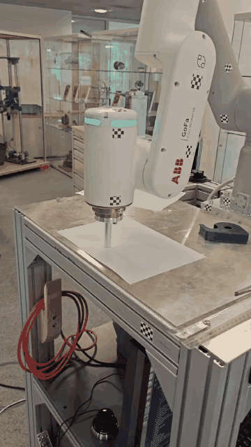

# Robot Dynamics and Motion Planning

Coursework and implementation work from the Robot Dynamics project. The repository contains Python implementations and exercises for robot kinematics, inverse kinematics, dynamics, trajectory planning, and a planned ABB GoFa drawing trajectory.

## TUM logo drawing trajectory

For the drawing task, I planned a Cartesian path for the robot tool and converted it into a joint-space trajectory. The motion is organized as approach, drawing, and retract stages. The code in `src/tum_logo_planner.py` generates the trajectory and intermediate stage data; the video below shows the TUM logo drawing demonstration.

<p align="center">
  <a href="media/tum_logo_trajectory.mp4">
    
  </a>
</p>

Click the preview to open the full video.

## What is included

- Forward and inverse kinematics, including numerical inverse-kinematics methods.
- Robot dynamics and simulation utilities.
- Joint-space and Cartesian trajectory planning, with trajectory data and plotting helpers.
- A TUM logo drawing task for the ABB GoFa model.
- Robot Dynamics course exercises, lecture slides, and scripts collected in [`documents/`](documents/).

## Repository layout

```text
src/          Python implementations, robot models, and trajectory data
documents/    Course exercise sheets, lecture slides, and reference scripts (PDF)
media/        TUM logo drawing video
```

The PDF files are course materials and references; the implementations and project code are in `src/`.
