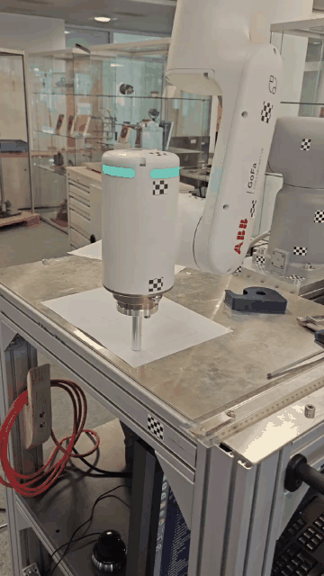

# Robotics and Mechanical Engineering Projects

This repository brings together selected work in robot dynamics, motion planning, and hands-on mechanical design. The code and coursework files remain available alongside short visual demonstrations.

## ABB GoFa: planned-motion execution

I used an ABB GoFa robot to check planned motion trajectories on physical hardware. This gave me practical experience comparing a planned motion with its execution on a real robot.

  

[Watch the ABB GoFa demonstration](media/abb_gofa_trajectory_demo.mp4)

The repository also contains robot-dynamics coursework and code related to kinematics, inverse dynamics, and trajectory planning.

## Tower crane: design and physical prototype

I took a small tower-crane project from the initial design and component choices through assembly and a working physical prototype. I also used 3D printing for small parts, including a motor bracket, and tested the assembled mechanism.

  
  

[Watch the tower-crane demonstration](projects/tower-crane/tower_crane_build_demo.mp4)

## Undergraduate mechanical-design project

For my undergraduate capstone, I designed a polishing-machine assembly in CAD. The model shows the overall machine layout and mechanical integration of its main assemblies.

  

## Topics and tools

- Robot kinematics, inverse dynamics, and trajectory planning
- ABB GoFa trajectory execution
- Mechanical CAD and assembly design
- 3D-printed parts and physical prototyping

