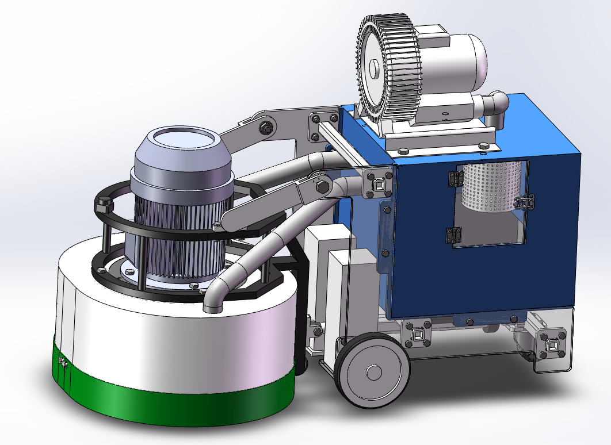

# Undergraduate Capstone: Polishing-Machine Design

Mechanical-design capstone completed during my bachelor's degree in Mechanical Design, Manufacturing and Automation. The CAD assembly brings the machine's main components together and shows their overall mechanical layout.

  

