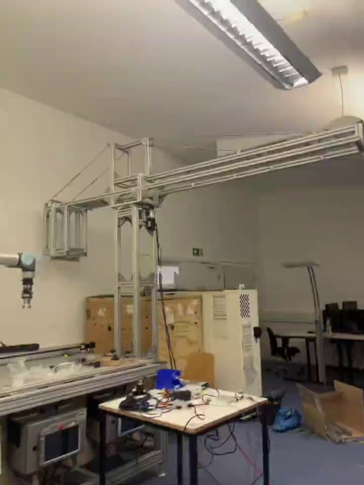
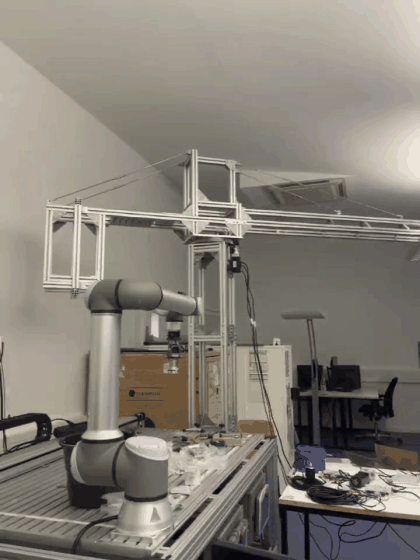

# Tower Crane Design and Prototype

A hands-on mechanical project taken from the initial concept and component selection through CAD, assembly, and a working prototype. The mechanism was tested physically, and 3D printing was used for small parts, including a motor bracket.

  
  

[Watch the prototype test](tower_crane_build_demo.mp4)

